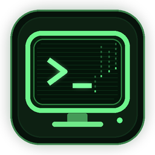
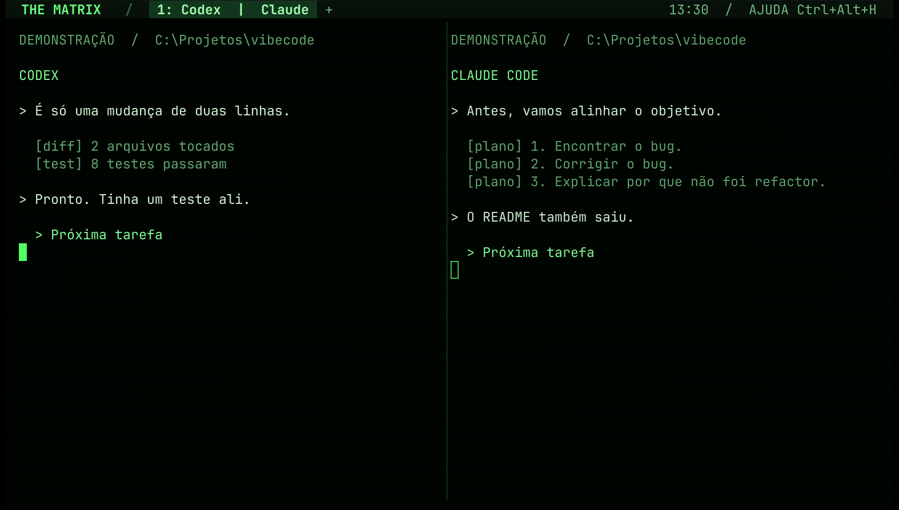
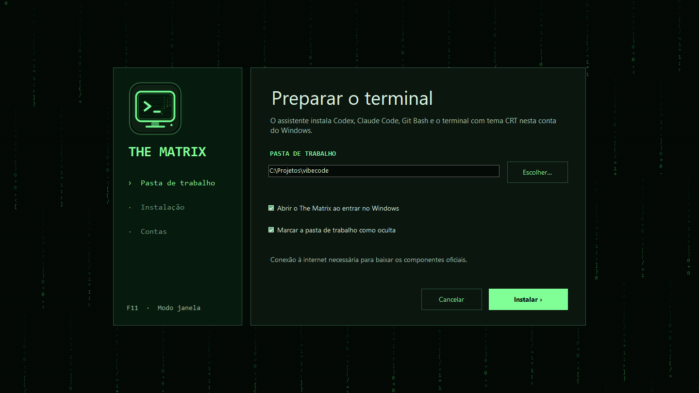
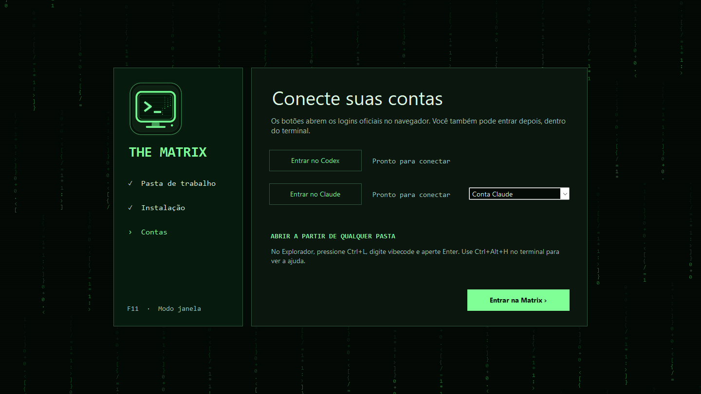

<p align="center">
  
</p>

<h1 align="center">The Matrix</h1>

<p align="center"><strong>Codex à esquerda. Claude à direita. O Git que lute.</strong></p>

<p align="center">
  <a href="https://github.com/void3333/the-matrix-terminal/releases/latest">Baixar para Windows x64</a> ·
  <a href="#como-usar">Atalhos e comandos</a> ·
  <a href="#compilar-o-instalador">Código e compilação</a>
</p>

**The Matrix** é um terminal para Windows que abre Codex e Claude Code lado a lado, em tela cheia, na pasta que você escolher. A tela tem fundo preto opaco, letras verdes e linhas de CRT. Digite `vibecode` na barra de endereço do Explorador para abrir a dupla na pasta atual.



*O print usa o tema e a janela reais. As falas são fictícias; nenhum dos dois precisou depor.*

## Instalação

1. Baixe o [The-Matrix-Setup-1.0.0.exe](https://github.com/void3333/the-matrix-terminal/releases/download/v1.0.0/The-Matrix-Setup-1.0.0.exe) e execute-o em um **Windows x64** com internet.
2. Escolha a pasta de trabalho. O assistente também permite ocultá-la e abrir o terminal automaticamente ao entrar no Windows.
3. O instalador baixa e verifica WezTerm, PowerShell 7, Git Bash, Oh My Posh, Codex e Claude Code. Na tela **Contas**, cada botão abre o fluxo de login do respectivo serviço.
4. Clique em **Entrar na Matrix** para abrir os dois painéis na pasta selecionada.

O instalador é executado na sua conta do Windows e não tem assinatura digital própria. A release inclui o arquivo `SHA256.txt` para conferir o download com `Get-FileHash .\The-Matrix-Setup-1.0.0.exe`.



<details>
<summary>Ver a tela de login</summary>



O login acontece no navegador. Você pode pular essa etapa e entrar depois pelo terminal, com `codex login` e `claude auth login`.

</details>

## Como usar

| Atalho | O que faz |
| --- | --- |
| **Ctrl+L → `vibecode` → Enter** | Abre a dupla na pasta atual do Explorador. |
| **Ctrl+Shift+O** | Escolhe outra pasta e abre a dupla em uma nova janela. |
| **Ctrl+Alt+H** | Abre a ajuda numa aba PowerShell. |
| **Ctrl+Shift+T** | Abre uma aba PowerShell. |
| **Ctrl+Alt+← / →** | Alterna entre os painéis. |
| **F11** | Alterna entre tela cheia e modo janela. |

No PowerShell, digite `vhelp` para ver os comandos. Os que evitam mais passeios pelo Explorador:

- `vgo 'C:\Meus Projetos'` muda de pasta, `vup 2` sobe dois níveis e `vback` volta para a pasta anterior.
- `vroot` vai para a raiz do repositório Git. `vls` lista o conteúdo da pasta.
- `vopen .` abre Codex e Claude juntos na pasta atual.

Se apareceu um gato preto duas vezes, talvez você tenha encontrado um easter egg. A primeira pista é `redpill`.

## Primeiro round

No Codex:

> Encontre o menor patch que resolve esse bug e diga qual teste comprova a correção. Por enquanto, só analise.

No Claude:

> Revise a proposta do outro painel. Procure um caso de borda que o teste não cobre e sugira como reproduzi-lo. Por enquanto, só analise.

Depois, escolha o que vale aplicar. Duas IAs podem discutir à vontade; nada obriga as duas a editar o mesmo arquivo ao mesmo tempo.

## Compilar o instalador

Em Windows x64, com o compilador C# do .NET Framework disponível, rode na raiz do repositório:

```powershell
powershell.exe -NoProfile -ExecutionPolicy RemoteSigned -File .\scripts\build.ps1
```

O executável e o checksum saem em `dist\`. O [assistente](installer/Setup.cs), o [launcher](launcher/Vibecode.cs) e o [tema do terminal](terminal/matrix-theme.lua) ficam neste repositório. Os clientes são baixados dos fornecedores na instalação. Veja os [componentes de terceiros](THIRD-PARTY.md) para detalhes.
